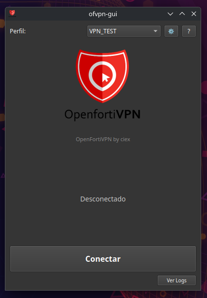
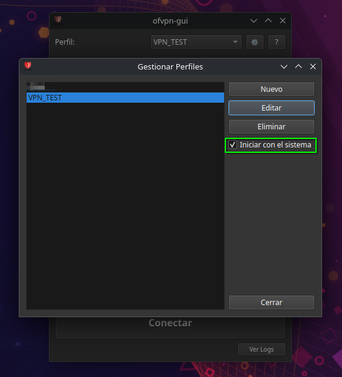
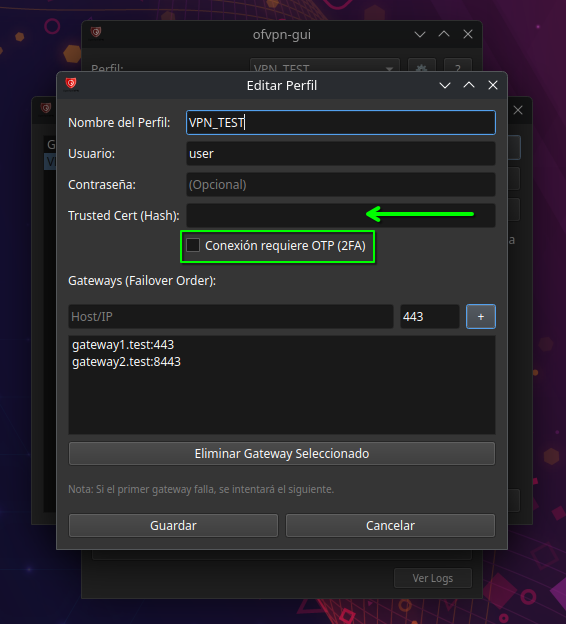
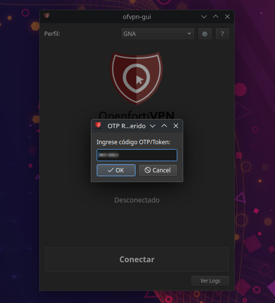
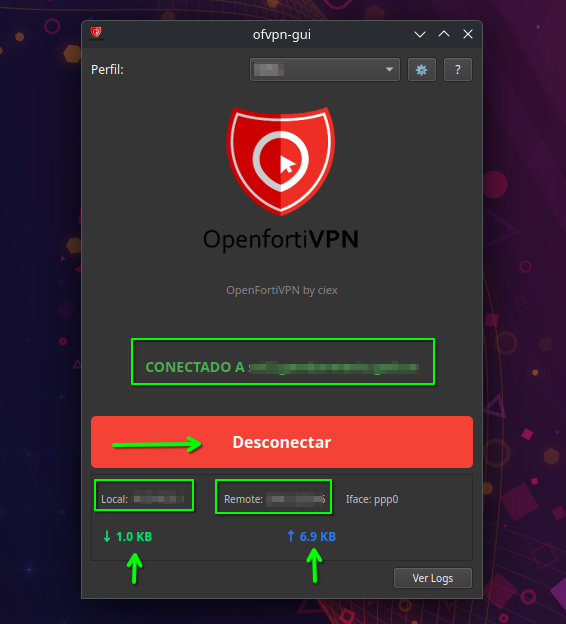
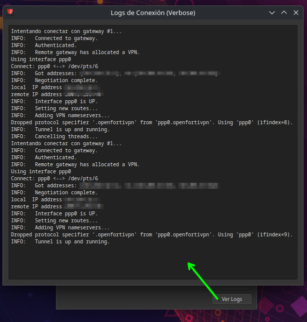

# VPN GNA (Dual SSL / IPSec)

Cliente gráfico de escritorio moderno, seguro y optimizado para conexiones VPN institucionales en Linux, desarrollado con **Python 3.8+** y **PySide6** (Qt para Python).

Diseñado específicamente para el ecosistema de seguridad de **Gendarmería Nacional Argentina (GNA)**, ofreciendo una arquitectura de motor dual (Dual-Stack) para la transición transparente de concentradores VPN-SSL a **IPSec IKEv2**.

**Versión Actual:** v2.0 (Dual Engine)








## Novedades v2.0 (Dual Engine GNA)

*   **Motor IPSec Nativo (strongSwan)**: Soporte completo para túneles IKEv2 con autenticación EAP (MSCHAPv2), compatibilidad con FortiGate IPSec y 2FA/OTP (FortiToken).
*   **Motor SSL Continuo (openfortivpn)**: Soporte retrocompatible con concentradores SSL existentes durante el período de migración.
*   **Identidad de Usuario en Tiempo Real**: Visualización prominente y dinámica del usuario conectado (`👤 Usuario: <usuario>`) en la pantalla principal.
*   **Migración Automática**: Detección y migración transparente de perfiles y contraseñas seguras en Keyring desde `ofvpn-gui` hacia `vpn-gna`.
*   **Gestión de Secretos en RAM (Hardening)**: Archivos de configuración efímeros generados exclusivamente en memoria volátil (`/run/user/<uid>/vpn-gna/`) con permisos `0600` y eliminados inmediatamente post-carga.
*   **Métricas de Tráfico Agnósticas**: Monitoreo de RX/TX tanto para interfaces de túnel clásicas (`pppX`) como para asociaciones de seguridad IPSec (`sa:net`).

## Características Principales

*   **Interfaz Moderna**: Tema oscuro (Fusion Dark) adaptativo e indicadores visuales de estado.
*   **Gestor de Perfiles Dual**: Creación y edición de perfiles diferenciando perfiles SSL e IPSec, puertos dinámicos y ocultamiento inteligente de parámetros.
*   **Multi-Gateway & Failover**: Permite configurar múltiples gateways de respaldo. Si el concentrador principal no responde, el cliente conmuta de inmediato al siguiente.
*   **Seguridad y Constitución**:
    *   Cero contraseñas en texto plano en disco no volátil.
    *   Almacenamiento protegido en el Keyring del sistema.
    *   Captura modal e interactiva de Tokens OTP (2FA).
*   **Integración en Bandeja del Sistema (System Tray)**: Minimizado a la bandeja y notificaciones nativas de escritorio.

## Requisitos del Sistema

*   Linux (Probado en **KDE Plasma**, GNOME, XFCE).
*   Python 3.8+.
*   `openfortivpn` (motor SSL).
*   `strongswan` y `swanctl` (motor IPSec).
*   `systemd-resolved` (`resolvectl`) para Split-DNS.

## Instalación Rápida

El proyecto incluye un script de instalación automatizado que se encarga de las dependencias, el entorno virtual y el lanzador de escritorio.

1.  Clona el repositorio:
    ```bash
    git clone https://github.com/ivancarneiro/openfortivpn-gui.git
    cd openfortivpn-gui
    ```

2.  Ejecuta el instalador:
    ```bash
    ./install.sh
    ```

3.  ¡Listo! Busca "OpenFortiVPN GUI" en tu menú de aplicaciones.

## Configuración Avanzada: Modo Sin Contraseña

Por defecto, la aplicación solicitará su contraseña de usuario (sudo) para iniciar la conexión VPN, ya que `openfortivpn` requiere permisos de root. 

Para habilitar una experiencia **totalmente fluida sin contraseñas** (tanto para conectar como para desconectar), ejecute el siguiente script una única vez:

```bash
./configure_permissions.sh
```

Esto añadirá una regla segura en `/etc/sudoers.d/` permitiendo ejecutar solo la VPN y el comando de cierre específico sin password.

## Uso y Solución de Problemas

*   **Logs**: Si tienes problemas, revisa `~/.config/vpn-gna/debug.log` o el diálogo de logs dentro de la aplicación.
*   **Permisos**: Si la aplicación no guarda la configuración, asegúrate de ser el dueño de la carpeta de config: `sudo chown -R $USER:$USER ~/.config/vpn-gna`.
*   **Desconexión**: Use el botón "Desconectar" de la app. Si cierra la ventana con la `X`, la aplicación se minimizará a la bandeja. Para cerrar completamente, use Clic Derecho en el icono del tray -> Salir.

## Contribuir

¡Las contribuciones son bienvenidas! Por favor abre un issue o envía un pull request.

## Licencia

MIT License. Ver archivo `LICENSE` para más detalles.

---
Desarrollado con ❤️ por ciex.
