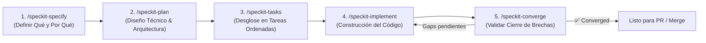

# Spec-Driven Development (SDD) — Guía del Shorter Path

Esta guía documenta el flujo de trabajo **Shorter Path (Ruta Corta)** utilizando **GitHub Spec Kit** en el proyecto **OpenFortiVPN GUI**, optimizado para el asistente de inteligencia artificial **Gemini** en Antigravity.

---

## 1. ¿Qué es el Shorter Path?

El **Shorter Path** es un flujo de desarrollo guiado por especificaciones (Spec-Driven Development) diseñado específicamente para **características pequeñas, mejoras incrementales y correcciones acotadas**. 

A diferencia del flujo completo (*Full Path*), el Shorter Path omite los puntos de control intermedios de clarificación profunda (`/speckit-clarify`), listas de verificación de requisitos (`/speckit-checklist`) y análisis estático de artefactos (`/speckit-analyze`), permitiendo pasar velozmente de la idea al código garantizando la calidad y la trazabilidad.

### Los 5 Pasos del Ciclo



---

## 2. Detalle de los Comandos

Tanto la sintaxis `/speckit.<comando>` como `/speckit-<comando>` están configuradas en `.gemini/commands/` para su ejecución directa en el chat de Gemini.

### Paso 1: `/speckit-specify` — Describir qué construir
* **Propósito**: Crea la especificación funcional inicial (`spec.md`) a partir de una descripción en lenguaje natural.
* **Enfoque**: Qué problema se resuelve y por qué, requisitos funcionales (`FR-###`), criterios de éxito (`SC-###`) e historias de usuario con criterios de aceptación. **No debe incluir detalles técnicos de implementación**.
* **Ejemplo**:
  ```text
  /speckit-specify Agregar un temporizador en tiempo real en la ventana principal que muestre la duración de la conexión VPN activa (HH:MM:SS), reiniciándose al desconectar o reconectar.
  ```

### Paso 2: `/speckit-plan` — Definir la arquitectura y stack técnico
* **Propósito**: Traduce la especificación en un plan de arquitectura concreto (`plan.md`).
* **Enfoque**: Decisiones técnicas específicas del proyecto `openfortivpn-gui` (PySide6, widgets Qt, hilos con `QTimer` o `QThread`, manipulación de procesos en `VpnManager`, compatibilidad con Linux y permisos).
* **Ejemplo**:
  ```text
  /speckit-plan Usar PySide6 con un QLabel centrado sobre el botón de conexión. Emplear un QTimer de 1000ms conectado a la señal de estado de VpnManager (iniciar al conectar, detener al desconectar).
  ```

### Paso 3: `/speckit-tasks` — Desglosar el trabajo en tareas
* **Propósito**: Convierte el plan de implementación en una lista estructurada y accionable de tareas en orden de dependencia (`tasks.md`).
* **Enfoque**: Tareas atómicas con checkboxes (`- [ ] T001 ...`), agrupadas por fases (Fase 1: Preparación, Fase 2: Implementación Core, Fase 3: Validación).
* **Ejemplo**:
  ```text
  /speckit-tasks
  ```

### Paso 4: `/speckit-implement` — Construir el código
* **Propósito**: Ejecuta las tareas definidas en `tasks.md` de forma secuencial y ordenada.
* **Enfoque**: Modifica y crea el código fuente de `src/`, asegurando que no se rompan las restricciones de la [Constitución del Proyecto](file:///.specify/memory/constitution.md) (seguridad de credenciales, separación de privilegios, no bloqueo del hilo principal de la GUI).
* **Ejemplo**:
  ```text
  /speckit-implement
  ```

### Paso 5: `/speckit-converge` — Verificar completitud
* **Propósito**: Compara el estado real del código base contra `spec.md`, `plan.md` y `tasks.md`.
* **Enfoque**:
  * Si detecta brechas o código faltante/incompleto, añade automáticamente una fase `## Phase N: Convergence` al final de `tasks.md` con las tareas correctivas necesarias. Luego se vuelve a ejecutar `/speckit-implement`.
  * Si todo está completo y satisfecho, reporta: `✅ Converged — the implementation satisfies the spec, plan, and tasks`.
* **Ejemplo**:
  ```text
  /speckit-converge
  ```

---

## 3. Prerrequisitos y Constitución del Proyecto

Antes de iniciar cualquier flujo SDD en este repositorio:
1. **Constitución Ratificada**: Se encuentra documentada en [`.specify/memory/constitution.md`](file:///.specify/memory/constitution.md). Establece las reglas no negociables de seguridad (cero credenciales en texto plano, uso de keyring del sistema, limpieza segura de temporizadores/procesos huérfanos y no bloqueo del hilo de interfaz gráfica PySide6).
2. **Contexto de la Característica**: Las especificaciones y tareas se almacenan en el directorio `specs/<feature-name>/`, rastreado en `.specify/feature.json`.

---

## 4. Integración con las Skills de Matt Pocock

Este entorno cuenta además con el paquete completo de **37 Skills de Matt Pocock** instaladas en [`.agents/skills/`](file:///.agents/skills/). Estas skills potencian el ciclo del Shorter Path en momentos clave:

| Skill | Momento de Uso |
|---|---|
| `/setup-matt-pocock-skills` | Configuración inicial de issue tracker, etiquetas de triage y documentación del dominio (`docs/agents/`). |
| `/tdd` | Complemento en `/speckit-implement` para desarrollo guiado por pruebas (Red-Green-Refactor). |
| `/diagnosing-bugs` | Diagnóstico metódico cuando un fallo o regresión ocurre durante la ejecución. |
| `/code-review` | Revisión de código paralela (Estándares vs. Especificación) tras finalizar la convergencia. |
| `/grill-me` | Entrevista interactiva para afinar detalles de diseño antes de ejecutar `/speckit-plan`. |
