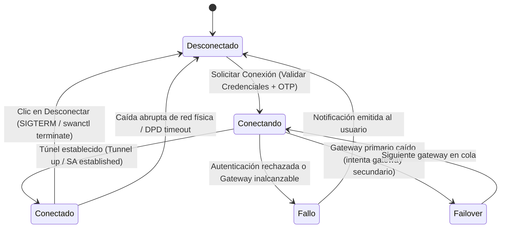

# Data Model: VPN-GNA Dual SSL / IPSec

**Feature**: `specs/001-dual-vpn-gna/spec.md`  
**Date**: 2026-10-14  

---

## 1. Entidades del Dominio

### 1.1 Perfil de Conexión (`Profile`)
Representa la configuración completa de un túnel VPN que el usuario puede seleccionar y conectar.

```json
{
  "id": "UUID-v4 (string)",
  "name": "string (1-64 chars)",
  "vpn_type": "enum ['ssl', 'ipsec'] (default: 'ssl' para perfiles heredados)",
  "username": "string (identidad del usuario)",
  "gateways": [
    {
      "host": "string (FQDN o IPv4)",
      "port": "integer (1-65535, por defecto 443 para SSL, 500 para IPSec)"
    }
  ],
  "otp_enabled": "boolean (indica si requiere 2FA/token en cada conexión)",
  "dns_domain": "string (opcional, lista de dominios split-DNS separados por espacio/coma)",
  "trusted_cert": "string (opcional, hash SHA256 para SSL, nulo en IPSec)",
  "ike_version": "integer [1, 2] (solo IPSec, por defecto 2)",
  "created_at": "string ISO-8601",
  "updated_at": "string ISO-8601"
}
```

#### Reglas de Validación:
- `id`: No nulo, único en la lista de perfiles.
- `name`: Obligatorio, no vacío, longitud máxima de 64 caracteres.
- `vpn_type`: Debe ser estrictamente `'ssl'` o `'ipsec'`. Perfiles sin este campo migran a `'ssl'`.
- `gateways`: Al menos un gateway válido con host no vacío y puerto en rango 1-65535.
- `username`: Obligatorio, no vacío.
- `trusted_cert`: Solo permitido en `vpn_type == 'ssl'`.
- `ike_version`: Solo aplicable en `vpn_type == 'ipsec'` (fijo en `2`).

---

### 1.2 Credenciales Seguras (`Credentials`)
Almacenadas exclusivamente en el Llavero del Sistema Operativo (`keyring` / SecretService).

- **Servicio Keyring**: `vpn-gna` (con migración retrocompatible desde `openfortivpn-gui`).
- **Clave / Username**: `profile_<profile_id>`.
- **Valor**: Contraseña del usuario (string protegido).
- **Zero Plaintext**: **NUNCA** se almacena en disco ni en `profiles.json`. Si el usuario opta por no guardar la contraseña, se mantiene en memoria volátil únicamente durante la conexión.

---

### 1.3 Sesión VPN Activa (`VPNSession`)
Estructura en memoria que refleja el estado operativo del enlace en tiempo real.

```python
{
    "profile_id": str,
    "vpn_type": "ssl" | "ipsec",
    "state": "disconnected" | "connecting" | "connected" | "failover",
    "gateway_host": str,
    "local_ip": str,         # Asignada por el concentrador (VIP)
    "remote_ip": str,
    "dns_servers": list[str],
    "interface": str | None, # "ppp0" o "tun0" para SSL; "sa:<ike_sa>" para IPSec
    "start_time": float | None,
    "rx_bytes": int,
    "tx_bytes": int
}
```

---

## 2. Máquina de Estados de la Conexión


