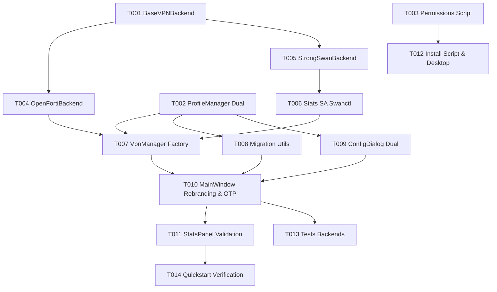

# Tasks: VPN-GNA Dual SSL / IPSec

**Feature**: `specs/001-dual-vpn-gna/spec.md`  
**Plan**: `specs/001-dual-vpn-gna/plan.md`  
**Date**: 2026-10-14  
**Orchestration**: Supervisor Multi-Agente / Pool de Especialistas (`parallel_dissection.json`)

---

## Mapa de Asignación de Agentes y Scopes

| Prefijo | Agente Asignado | Scope Autorizado | Tipo de Conventional Commit |
| :--- | :--- | :--- | :--- |
| `[CORE]` | `agent_vpn_core` | `src/vpn_manager.py`, `src/backends/`, `configure_permissions.sh` | `feat(vpn): ...`, `fix(vpn): ...` |
| `[SEC]` | `agent_security_storage` | `src/profile_manager.py`, `src/migration_utils.py` | `feat(sec): ...`, `fix(sec): ...` |
| `[UI]` | `agent_ui_desktop` | `src/main.py`, `src/config_dialog.py`, `src/stats_panel.py`, `src/styles.py` | `feat(ui): ...`, `fix(ui): ...` |
| `[TEST]` | `agent_qa_testing` | `tests/`, `install.sh`, `update.sh`, `assets/` | `test(vpn): ...`, `chore(packaging): ...` |

---

## Fase 1: Infraestructura Base y Contratos de Dominio (Foundational)

**Objetivo**: Establecer los contratos de interfaz base y la persistencia de datos requeridos por todos los componentes antes de la implementación paralela.

- [x] T001 [CORE] Crear interfaz abstracta `BaseVPNBackend` en `src/backends/base.py` con señales Qt estandarizadas (`state_changed`, `log_message`, `traffic_stats_updated`, `connection_details_received`, `connection_failed`) según contrato [vpn-backend-contract.md](file:///home/ciex/openfortivpn-gui/specs/001-dual-vpn-gna/contracts/vpn-backend-contract.md).
- [x] T002 [P] [SEC] Actualizar modelo y validación en `src/profile_manager.py` para soportar esquema dual (`vpn_type: 'ssl' | 'ipsec'`, `ike_version`, defaults seguros y retrocompatibilidad con perfiles existentes) según [profile-schema.json](file:///home/ciex/openfortivpn-gui/specs/001-dual-vpn-gna/contracts/profile-schema.json).
- [x] T003 [P] [CORE] Actualizar script de privilegios `configure_permissions.sh` para crear `/etc/sudoers.d/vpn-gna` incluyendo permisos sin contraseña para `/usr/sbin/swanctl`, `/usr/bin/openfortivpn`, `/usr/bin/killall openfortivpn` y `/usr/bin/resolvectl`.

**Checkpoint**: Contratos y esquemas de datos listos. Se desbloquean los motores y la UI.

---

## Fase 2: Motores de Conexión (Backends) & Orquestación Core

**Objetivo**: Implementar de forma aislada los dos motores de conexión y el orquestador polimórfico de `VPNManager`.

- [x] T004 [CORE] [US2] Implementar `OpenFortiBackend` en `src/backends/openforti_backend.py` encapsulando `VPNRunner`, monitor de salida regex, detección de certificados y stop graceful con SIGTERM/killall.
- [x] T005 [CORE] [US1] Implementar `StrongSwanBackend` en `src/backends/strongswan_backend.py`:
  - Generación de `swanctl.conf` efímero en RAM (`/run/user/<uid>/vpn-gna/`) con permisos `0600` según [swanctl-template-contract.md](file:///home/ciex/openfortivpn-gui/specs/001-dual-vpn-gna/contracts/swanctl-template-contract.md).
  - Invocación de `sudo -n swanctl --load-all` y borrado inmediato del archivo en RAM.
  - Invocación asíncrona de `sudo -n swanctl --initiate` y monitoreo del túnel.
  - Implementación de `disconnect_backend()` con `sudo -n swanctl --terminate` y `--unload-conn`.
- [x] T006 [CORE] [US4] Implementar sondeo de métricas SA en `src/backends/strongswan_backend.py` extrayendo `bytes-in` y `bytes-out` de `swanctl --list-sas` para emitir `traffic_stats_updated(rx, tx)`.
- [x] T007 [CORE] [US1] [US2] Refactorizar `src/vpn_manager.py` para actuar como Factory y Orquestador:
  - Instanciar dinámicamente `OpenFortiBackend` o `StrongSwanBackend` según `profile.vpn_type`.
  - Reenviar señales Qt hacia la GUI de manera transparente y desacoplada.
  - Manejo unificado de cola de gateways y failover.
  - Propagar identidad del usuario conectado (`username`) en `session_data` para consumo de la UI.

**Checkpoint**: Ambos motores funcionales a nivel de backend.

---

## Fase 3: Migración Automática y Llavero Seguro

**Objetivo**: Asegurar la transición transparente de datos desde OpenFortiVPN-GUI hacia VPN-GNA sin pérdida de perfiles ni contraseñas.

- [x] T008 [SEC] [US3] Actualizar `src/migration_utils.py` para implementar migración automática en el primer arranque:
  - Detectar si existe `~/.config/ofvpn-gui/` y no `~/.config/vpn-gna/`.
  - Migrar `profiles.json` asignando `"vpn_type": "ssl"` a los perfiles antiguos.
  - Migrar credenciales almacenadas en el Keyring desde el servicio `openfortivpn-gui` al nuevo servicio `vpn-gna`.
  - Configurar rutas por defecto en `src/profile_manager.py` apuntando a `~/.config/vpn-gna/`.

**Checkpoint**: La capa de almacenamiento y migración opera bajo el nuevo espacio de nombres.

---

## Fase 4: Presentación en Interfaz Gráfica (UI Desktop)

**Objetivo**: Adaptar la interfaz gráfica al soporte dual, rebranding visual y captura interactiva de 2FA/OTP.

- [x] T009 [UI] [US2] Actualizar `src/config_dialog.py`:
  - Agregar combobox selector de tipo de VPN (`SSL (OpenFortiVPN)` vs `IPSec (strongSwan)`).
  - Conectar cambio de tipo para mostrar/ocultar dinámicamente campos específicos (ocultar Trusted Cert en IPSec; mostrar gateways e identidad EAP).
  - Validar formulario según el tipo de VPN seleccionado antes de guardar.
- [x] T010 [UI] [US1] [US3] Actualizar `src/main.py`:
  - Aplicar rebranding a "VPN GNA" en título de ventana, tooltips de bandeja del sistema y notificaciones.
  - Agregar indicador visual prominente del usuario conectado (`self.user_label`: "Usuario: <username>") en la vista principal debajo del estado de conexión.
  - Adaptar el flujo de conexión: si el perfil tiene `otp_enabled == True`, abrir un diálogo `QInputDialog` modal y seguro para ingresar el código OTP de 6 dígitos.
  - Pasar el token OTP a `vpn_manager.connect_vpn(...)` en memoria volátil.
- [x] T011 [UI] [US4] Asegurar compatibilidad en `src/stats_panel.py` y `src/styles.py` para que el panel de estadísticas y temporizador reflejen idénticamente el tráfico de sesiones SSL e IPSec.

**Checkpoint**: Experiencia de usuario completa en la interfaz para perfiles duales.

---

## Fase 5: QA, Pruebas y Empaquetado

**Objetivo**: Validar el funcionamiento integral, estabilidad y scripts de instalación.

- [x] T012 [P] [TEST] [US3] Actualizar script de instalación `install.sh` y lanzador `vpn-gna.desktop` con nueva metadata, comando ejecutable y categorías de escritorio.
- [x] T013 [P] [TEST] [US1] [US2] Crear pruebas unitarias y de integración en `tests/test_backends.py` utilizando mocks para `swanctl` y `openfortivpn`.
- [x] T014 [TEST] Ejecutar validación de los escenarios de [quickstart.md](file:///home/ciex/openfortivpn-gui/specs/001-dual-vpn-gna/quickstart.md) (migración, alta de perfil IPSec, conexión, tráfico RX/TX y desconexión limpia).

---

## Dependencias y Paralelismo

